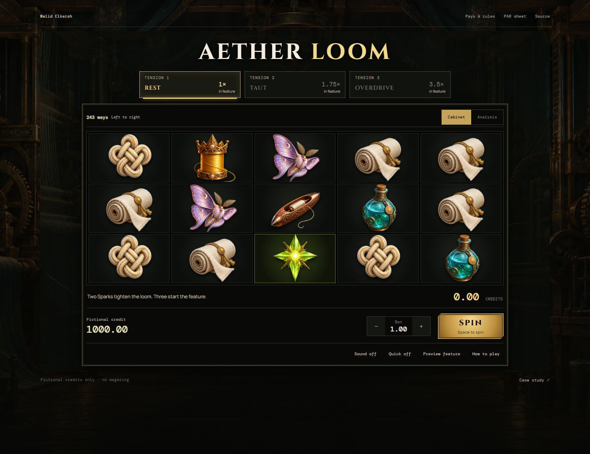
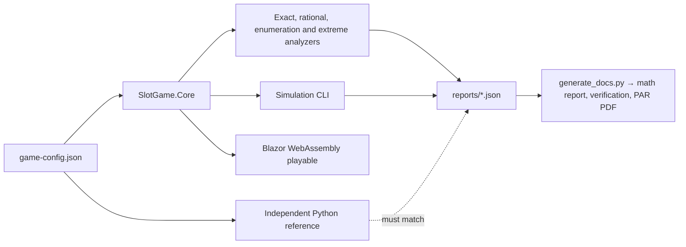

# Aether Loom: slot game mathematics, end to end

[**PLAY LIVE**](https://walidelkersh.github.io/aether-loom/) · [**PAR SHEET (PDF)**](docs/PAR-sheet.pdf) · [**MATH REPORT**](docs/math.md) · [**VERIFICATION**](docs/math.md#verification) · 

An original 5×3, 243-ways slot designed from physical reel strips up. Spark symbols move a persistent
**Rest → Taut → Overdrive** tension state that selects the next reel set and becomes the starting stage of a 7–12 spin
feature. I designed the mechanic and paytable, derived the exact RTP and volatility with a Markov-chain model, built the
C# engine, simulator and a playable Blazor client, and verified the math several independent ways. Fictional credits only.

## What this project demonstrates

| Game-math skill | Evidence in this repo |
|---|---|
| Exact RTP from physical reel strips | [`ExactAnalyzer`](src/SlotGame.Core/ExactAnalysis.cs): window distributions → ways EV → Markov chain → feature recursion |
| Exact volatility, not just simulated | [`ParAnalyzer`](src/SlotGame.Core/DistributionAnalysis.cs): all 40⁵ = 102.4M stop combinations per reel set in about 1 s; variance, SD, volatility index, hit rate, win distribution |
| PAR sheet in studio format | [PDF](docs/PAR-sheet.pdf) generated from the machine reports: paytable, strip counts, RTP budget, Markov chain, volatility, win distribution |
| Markov chains and stateful features | Stationary distribution by direct solve, fundamental matrix, relative state values, correlation-corrected variance σ²∞ |
| Monte Carlo done properly | Seeded PCG32, Welford moments, batch-means CI, exact correlation-corrected CI, chi-square test of the win distribution |
| Independent verification | [Python reference](scripts/independent_check.py) written from the rules, sharing no code with C#; it produces the **identical RTP fraction**; CI fails on any mismatch |
| Finding design exploits | [Bet-switching analysis](docs/advantage-play.md): 152.23% return under v1.0's shared state, fixed with per-bet-level state |
| Exposure / max-win analysis | [`ExtremeAnalyzer`](src/SlotGame.Core/ExtremeAnalysis.cs): reachable maximum via dynamic programming that propagates impossible branches |
| Balancing and sensitivity | [One-at-a-time sweeps](docs/sensitivity-analysis.md) over Wild density, Spark density, multipliers, free spins |
| Production-minded C# | Decimal settlement, injectable `IRandomSource`, config validation, 56 xUnit tests, GitHub Actions CI, Playwright E2E |

## PAR at a glance

| Metric | Value | How it is known |
|---|---:|---|
| **Total RTP** | **96.566915%** | Exact (rational fraction, 20 dp: 0.96566914833464226035) |
| Base game / feature | 80.431642% / 16.135273% | Exact |
| Hit frequency (any award) | 65.0918% (1 in 1.536) | Exact enumeration |
| Feature frequency | 0.420624% (1 in 237.74) | Exact |
| Average feature award | 38.36× bet over 8.37 spins | Exact |
| Standard deviation | 3.8617× bet (variance 14.9124) | Exact enumeration |
| Volatility index (90%) | 6.35 | Exact (1.645 σ) |
| Long-run variance with state correlation | 14.8320 (−0.54% vs. i.i.d.) | Exact (fundamental matrix) |
| Stationary state mix | 93.21% / 6.30% / 0.49% | Exact |
| Conditional RTP by state | 91.29% / 153.09% / 372.09% | Exact |
| Max base award / max paid cycle | 88.00× / 11,227.60× | Exact, reachable outcomes only |
| Simulated RTP, 10M spins (seed 20260908) | 96.638977% | z = +0.59 against exact, correlation-corrected |
| Largest observed award | 731.79× | Simulation (not the maximum) |

## Verification, in one table

| Check | Result |
|---|---|
| Float analyzer vs. BigInteger rational analyzer vs. 40⁵ enumeration | Agree; closed-form and enumerated ways EV are identical fractions |
| Independent Python implementation from the written rules | Identical RTP fraction |
| 10M-spin simulation, 95% CI: i.i.d. / batch means / exact σ∞ | ±0.240 / ±0.258 / ±0.239 pp; exact value inside all three |
| Chi-square, simulated vs. exact base win distribution | χ² = 5.64, 6 df, p = 0.46 |
| Hand-calculated fixtures | 8-way Crown = 3.20×, 4-reel extension = 7.20×, shared Wild = 0.37×, exact decimal settlement |
| Adversarial bet-switching player | 153.5% with shared state (v1.0) → 96.7% with per-bet state (v1.1) |

Details and limitations: [docs/math.md#verification](docs/math.md#verification).

## Version 1.1: review findings and fixes

A review of v1.0 found five issues that the RTP number alone did not reveal:

1. **Bet-switching exploit.** One tension state was shared across bet levels, so a player could build tension at 0.20 and spend it at 10.00 for a 152.23% return. State is now owned per bet level and cleared on cash-out ([advantage-play.md](docs/advantage-play.md)).
2. **Max-win analyzer added impossible events.** In a reduced-Spark configuration it reported 11,227× when the feature could not trigger; the reachable maximum is 49.60×. Impossible branches now propagate, and base-state reachability is checked.
3. **Tests checked consistency, not correctness.** The RTP test accepted anything from 94% to 97%. Tests now pin 12-digit values from the independent reference.
4. **Money held in `double`.** Settlement is now `decimal`. The 10M-spin run reproduces v1.0 to the last digit, which shows the change kept game behaviour identical.
5. **Documentation drift.** The spec said 48-stop reels (the build uses 40) and did not mention that BASE_OVERDRIVE and BONUS_REST share strips. Both are fixed and detected in code.

## Game rules

- Six named reel sets (five distinct strip configurations), each five circular 40-stop strips; a uniform stop shows that stop and the next two.
- 243 ways from reel 1 across 3+ consecutive reels; Wild substitutes (never on reel 1); different symbols add; longest match per symbol pays.
- **Tension** after a paid spin: 0 Sparks lowers, 1 holds, 2 raises; Overdrive always vents to Rest; 3+ Sparks trigger the feature and reset to Rest. Tension is stored per bet level.
- **Weave Ascending**: 7 free spins starting at the earned stage (1×, 1.75×, 3.5× multipliers and richer Wild strips). 2+ Sparks add a spin and raise the stage. Hard cap of 12 spins.

$$\text{RTP}=\sum_{s}\pi_s\,(B_s+t_sF_s),\qquad \pi P=\pi$$

## Architecture



- `src/SlotGame.Core`: strips, `IRandomSource`/PCG32, ways evaluator, game engine, `StateLedger`, and four analyzers.
- `src/SlotGame.Simulation`: CLI for simulation, PAR, bet-switch, sensitivity, and fixtures.
- `src/SlotGame.Playable`: browser cabinet that runs the same `SlotGame.Core` assembly as the tests.
- `tests/SlotGame.Tests`: 56 tests (exact-value, hand-calculated, invariant, exposure, statistical). `tests/e2e`: Playwright.
- `scripts/`: independent Python check, document and PAR generators, `reproduce.sh`.

## Run it

Requires .NET 8 SDK. Optional: Python 3.10+, Node 22 for E2E.

```bash
dotnet test AetherLoom.sln -c Release                                     # 56 tests
dotnet run --project src/SlotGame.Simulation -c Release -- --par          # exact PAR in ~1 s
dotnet run --project src/SlotGame.Simulation -c Release -- --spins 1000000
dotnet run --project src/SlotGame.Simulation -c Release -- --bet-switch   # exploit vs fix
dotnet run --project src/SlotGame.Simulation -c Release -- --help
python scripts/independent_check.py                                       # Python vs C#
dotnet run --project src/SlotGame.Playable                                # play locally
```

Reproduce every committed number and document: `bash scripts/reproduce.sh` (about one minute).

## Honest scope

This is a portfolio model, not a regulated product. It uses fictional credits, resolves outcomes in the browser, and uses
PCG32, a reproducible simulation generator that is not a certified RNG. It has not been reviewed by a test laboratory. It
shows I can design, derive, implement and verify a stateful slot model, and that I look for the places where it breaks.

## Further reading

[Game design spec](docs/game-design.md) · [Math report](docs/math.md) · [Verification](docs/math.md#verification) · [Advantage play](docs/advantage-play.md) · [Sensitivity](docs/sensitivity-analysis.md) · [Reel strips](docs/reel-strips.md)

Released under the [MIT License](LICENSE). The symbol atlas and backdrop are original generated assets; no third-party game art is included.
