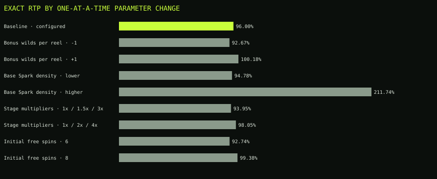

# Sensitivity analysis

Each row changes one parameter family. Exact RTP, feature frequency and **reachable** maximum exposure are recomputed
from the altered model; hit frequency and SD use 500,000 seeded paid spins per scenario.

| Parameter | Level | Exact RTP | Exact feature rate | Sim hit rate | Sim σ | Reachable max |
|---|---|---:|---:|---:|---:|---:|
| Baseline | configured | 96.0000% | 0.4206% | 64.0102% | 3.8551× | 11,227.60× |
| Bonus wilds per reel | -1 | 92.6698% | 0.4206% | 64.1298% | 3.1858× | 11,227.60× |
| Bonus wilds per reel | +1 | 100.1833% | 0.4206% | 64.2262% | 4.6643× | 11,563.60× |
| Base Spark density | lower | 94.7796% | 0.0000% | 69.1186% | 1.5207× | 49.60× |
| Base Spark density | higher | 211.7402% | 3.1288% | 61.0100% | 11.0464× | 11,247.30× |
| Stage multipliers | 1x / 1.5x / 3x | 93.9486% | 0.4206% | 64.1058% | 3.3242× | 9,626.60× |
| Stage multipliers | 1x / 2x / 4x | 98.0514% | 0.4206% | 64.1030% | 4.3864× | 12,828.60× |
| Initial free spins | 6 | 92.7361% | 0.4206% | 64.1332% | 3.3431× | 10,058.60× |
| Initial free spins | 8 | 99.3832% | 0.4206% | 64.1950% | 4.5136× | 12,396.60× |

- **Bonus Wild density** moves feature RTP and volatility: −1 Wild per bonus reel gives -3.33 pp, +1 gives +4.18 pp.
- **Base Spark density** drives both the state mix and feature entry. The high case raises feature frequency to 3.13% and RTP to 211.74%: a boundary experiment, not a candidate. In the low case BASE_REST has no Sparks, Rest is absorbing, and the feature can never trigger, so the reachable maximum collapses to 49.60×. *v1.0 reported 11,227.15× here because it added the feature maximum to an impossible 3-Spark branch; the analyzer now propagates impossibility and checks state reachability.*
- **Stage multipliers** change the feature budget without changing entry frequency: 93.95% and 98.05%.
- **Initial free spins** move RTP and variance together: six spins return 92.74%, eight 99.38%.

Rebalancing example: to double feature frequency at constant RTP, feature RTP = entry × average award
(0.4206% × 38.36 = 16.14%) means the average award must fall to about
19.2×. Because Sparks also drive the base state, adding Sparks shifts π toward the richer base sets as well,
so the whole model is re-solved rather than one term scaled.

